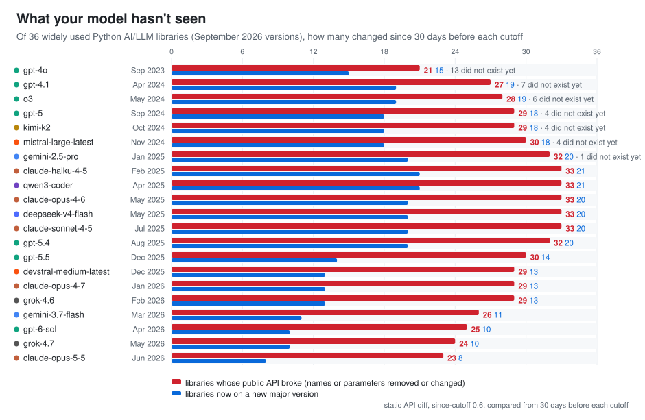

*The Python AI stack after each model's training cutoff · September 2026, re-run with since-cutoff
0.6 in October 2026 · [since-cutoff on GitHub](https://github.com/MohammadHijjawi97/since-cutoff)*

A coding model's training data ends at some date; the libraries it writes against keep changing
after it. To see how far, I pinned **36 widely used Python AI and LLM libraries** at their releases
of 26 September 2026
([the list](https://github.com/MohammadHijjawi97/since-cutoff/blob/main/examples/ai-stack/requirements.txt))
and ran `since-cutoff scan` against the training cutoff of **21 models from 8 vendors**: OpenAI,
Anthropic, Google, xAI, DeepSeek, Qwen, Moonshot and Mistral. For each library, the scan takes
the comparison release, the latest one published at least 30 days before the model's training
cutoff, and diffs its public API against the pinned release, statically. No model was called for
this page.

The scan was first run with since-cutoff 0.2.0 in September 2026, again with 0.5.0 on 10 October
2026, and with 0.6 on 17 October 2026, on the same pins; the table and the chart are from the 0.6
run. Two things in 0.6 move the counts most. The earlier runs compared from the latest release on
or before the cutoff; 0.6 compares from 30 days before it, so a release from a model's last month
before its cutoff counts as one it may not know well, and the counts are of changes made after
that day, 30 days before the cutoff. And 0.6 counts changes to public APIs only, where the
earlier runs counted every change. Its diff also sees more kinds of change and reports fewer
false removals, which rarely alters whether a library has at least one. For 11 of the 21 models
the number of libraries with a public API break is the same as in the 0.5.0 run, for 5 it is
higher and for 5 lower, by 1 to 3 libraries; the largest change is Claude Opus 5.5's, 23 instead
of 20.

<picture>
  <source media="(prefers-color-scheme: dark)" srcset="img/ai-stack-dark.svg">
  
</picture>

## What it shows

- **For every model, most of the stack broke its public API since the releases it is compared
  with.** Even for the newest model here, Claude Opus 5.5 (training cutoff 30 June 2026,
  compared from releases up to 31 May 2026), **23 of the 36 libraries** broke their public API
  since, and 8 of them are on a new major version: `openai` 2.38 → 3.19, `anthropic` 0.105 → 1.8, `huggingface-hub`
  1.17 → 2.0, `mcp` 1.27 → 2.2, `pinecone` 9 → 10, `sentence-transformers` 5 → 6,
  `pydantic-ai-slim` 1.104 → 2.51 and `datasets` 4.8 → 5.0. The last two released their new
  major in the month before the cutoff (`datasets` 5.0.0 on 5 June 2026, `pydantic-ai-slim`
  2.0.0 on 23 June), which the 0.5.0 run, comparing from the cutoff itself, counted as known.
- **Models with cutoffs in the first half of 2025 have the most to catch up on.** For Claude
  Haiku 4.5, Qwen3 Coder, Claude Opus 4.6, DeepSeek V4 Flash and Claude Sonnet 4.5 (cutoffs
  February to July 2025), 33 of the 36 libraries broke their public API since, and 20 or 21 are
  on a new major version, including `openai`, `anthropic`, `langchain`, `langgraph`,
  `transformers`, `pandas` and `huggingface-hub`.
- **Older models count lower because much of the stack did not exist yet.** GPT-4o's training
  data (September 2023) predates any release of 13 of the 36 packages under their current names,
  among them `langgraph`, `mcp`, `crewai`, `smolagents` and `google-genai`. A model cannot write
  stale code for a library it has never seen, but it cannot write correct code for it either.
  With the margin, a library first released in the month before a cutoff is one of these too:
  `mcp` (first released on 20 November 2024) and `pydantic-ai-slim` (25 November 2024) for
  Mistral Large, whose cutoff is 30 November 2024.

## By model

| model | vendor | training cutoff | compared from releases up to | new release since (of 36) | did not exist yet | new major version | public API breaks | new deprecations |
|---|---|---|---|---|---|---|---|---|
| gpt-4o | OpenAI | 2023-09-30 | 2023-08-31 | 36 | 13 | 15 | 21 | 6 |
| gpt-4.1 | OpenAI | 2024-04-30 | 2024-03-31 | 36 | 7 | 19 | 27 | 11 |
| o3 | OpenAI | 2024-05-31 | 2024-05-01 | 36 | 6 | 19 | 28 | 11 |
| gpt-5 | OpenAI | 2024-09-30 | 2024-08-31 | 36 | 4 | 18 | 29 | 12 |
| kimi-k2 | Moonshot | 2024-10-31 | 2024-10-01 | 36 | 4 | 18 | 29 | 12 |
| mistral-large-latest | Mistral | 2024-11-30 | 2024-10-31 | 36 | 4 | 18 | 30 | 12 |
| gemini-2.5-pro | Google | 2025-01-31 | 2025-01-01 | 35 | 1 | 20 | 32 | 13 |
| claude-haiku-4-5 | Anthropic | 2025-02-28 | 2025-01-29 | 35 | 0 | 21 | 33 | 13 |
| qwen3-coder | Qwen | 2025-04-30 | 2025-03-31 | 35 | 0 | 21 | 33 | 13 |
| claude-opus-4-6 | Anthropic | 2025-05-31 | 2025-05-01 | 35 | 0 | 20 | 33 | 14 |
| deepseek-v4-flash | DeepSeek | 2025-05-31 | 2025-05-01 | 35 | 0 | 20 | 33 | 14 |
| claude-sonnet-4-5 | Anthropic | 2025-07-31 | 2025-07-01 | 35 | 0 | 20 | 33 | 14 |
| gpt-5.4 | OpenAI | 2025-08-31 | 2025-08-01 | 35 | 0 | 20 | 32 | 15 |
| gpt-5.5 | OpenAI | 2025-12-01 | 2025-11-01 | 34 | 0 | 14 | 30 | 13 |
| devstral-medium-latest | Mistral | 2025-12-31 | 2025-12-01 | 34 | 0 | 13 | 29 | 13 |
| claude-opus-4-7 | Anthropic | 2026-01-31 | 2026-01-01 | 34 | 0 | 13 | 29 | 12 |
| grok-4.6 | xAI | 2026-02-01 | 2026-01-02 | 34 | 0 | 13 | 29 | 12 |
| gemini-3.7-flash | Google | 2026-03-31 | 2026-03-01 | 34 | 0 | 11 | 26 | 11 |
| gpt-6-sol | OpenAI | 2026-04-20 | 2026-03-21 | 34 | 0 | 10 | 25 | 12 |
| grok-4.7 | xAI | 2026-05-31 | 2026-05-01 | 34 | 0 | 10 | 24 | 11 |
| claude-opus-5-5 | Anthropic | 2026-06-30 | 2026-05-31 | 31 | 0 | 8 | 23 | 11 |

"Compared from releases up to" is the training cutoff minus the 30-day margin: each library's
comparison release is its latest release published on or before that day. "New release since"
includes the libraries that did not exist yet. "Public API breaks" counts libraries with at
least one public name or parameter removed, moved, newly required or changed in kind; "new
deprecations" counts libraries that newly mark a public API as deprecated. Each change is public
or internal (internal: not reached from the package's top level, named in an `__all__` or
documented), and both columns count public changes only. Counting every change, as the 0.5.0 run
did, would add one or two libraries with a break for Gemini 3.7 Flash, GPT-6 Sol, Grok 4.7 and
Claude Opus 5.5, and one with new deprecations for GPT-4o.

## What this does and does not say

- **It counts libraries, not mistakes.** A library with a flagged break is one where code written
  from the model's memory *can* fail; whether a model actually writes the old call is what
  `since-cutoff run` measures, per project. On one sample project, measured with since-cutoff
  0.1.0, Claude Haiku 4.5 and Claude Opus 4.6 wrote stale code (valid for the comparison
  release, rejected by the type checker for the pinned one) for 3 of 5 and 2 of 4 probed libraries
  ([results](https://github.com/MohammadHijjawi97/since-cutoff#results)).
- **It is a static diff.** It sees names, parameters and deprecation markers in the public API,
  not behaviour changes behind an unchanged signature. Large libraries such as `transformers`
  report many changes, so this page counts libraries rather than changes.
- **It compares from 30 days before each cutoff.** Models know the last weeks before their
  cutoff least, so since-cutoff 0.6 takes, for each library, the latest release published at
  least 30 days before the model's training cutoff; `--cutoff-margin 0` compares from the cutoff
  itself, as the earlier runs of this page did. A change counted here can therefore come from
  those 30 days, before the cutoff, and the real gap can start earlier still.
- **Cutoff dates come from [models.dev](https://models.dev).** Vendors define them differently
  (Anthropic, for example, publishes both a "reliable knowledge" and a later "training data"
  cutoff). Each model was given by its id alone (`--model gpt-5`), which takes the cutoff from
  the model maker's own listing, or, for a model its maker does not list there, from the
  earliest listing. Kimi K2 and Qwen3 Coder are such models, and their listings disagree: Kimi
  K2's cutoff is given as October or December 2024 (0.6 takes October, as the 0.5.0 run did),
  Qwen3 Coder's as April, June or July 2025 (0.6 takes April; the 0.5.0 run had 31 July).
- **"Did not exist yet" means no release under that PyPI name by the comparison date,** yanked
  releases not counted. Some projects existed under another name (`dspy` was `dspy-ai`), and
  `google-genai`'s releases before January 2025 were all yanked later, so for Gemini 2.5 Pro it
  is one of these.

## Reproduce it

The pinned requirements file and the script that builds this page's table and chart are in
[`examples/ai-stack`](https://github.com/MohammadHijjawi97/since-cutoff/tree/main/examples/ai-stack).
No API key is needed: `scan` makes no model calls.

```bash
pip install since-cutoff
cd examples/ai-stack
mkdir -p scans
since-cutoff scan --model gpt-5 --json > scans/gpt-5.json
since-cutoff scan --model claude-opus-5-5 --json > scans/claude-opus-5-5.json
python stack_report.py scans      # writes stack.md, stack.json and the two chart SVGs
```

The first scan downloads the sources of each library at both versions; later scans reuse the
cache. Diffing `transformers` takes the longest: up to half an hour for each comparison release
on the machine that made this page.

Your own project is the more useful test: `uvx since-cutoff scan` in its root shows what changed
after your model's cutoff, and the
[MCP server](https://github.com/MohammadHijjawi97/since-cutoff#use-it-from-any-agent-mcp) lets
your agent ask before it writes the code.
